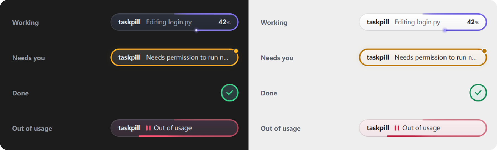

<h1 align="center">TaskPill</h1>

<p align="center"><b>Know what Claude Code is doing without switching windows.</b><br>
A small pill on your Windows taskbar that shows each Claude Code session's progress,<br>
tells you the moment it needs you, and lets you know when it's done.</p>

<p align="center">
  <a href="../../releases/latest"><b>Download for Windows</b></a> ·
  <a href="#on-your-taskbar">What it shows</a> ·
  <a href="#privacy">Privacy</a>
</p>

<p align="center"></p>

**Authors:** Manasvi Mittal

You give Claude Code a task and switch to something else. Then you keep checking back. Is it still going? Is it stuck on a permission prompt? Did it finish ten minutes ago? TaskPill answers that from the corner of your eye, and gets your attention only when you're needed.

## On your taskbar

<p align="center"></p>

- **Working:** the outline of the pill is the progress bar. A line of light runs round the edge as the estimated % grows, next to the step Claude is on ("Editing login.py", "Running npm test").
- **Needs you:** the pill turns amber with a soft glow and a dot, and shows what Claude is asking ("Needs permission to run npm install"). A subtle chime plays.
- **Done:** the pill shrinks to a mint ✓ with a softer chime. Click it, or just switch to that window, and it goes away.
- **Out of usage:** a calm crimson pill with a pause mark when you hit a usage limit. Hover it to see Claude Code's own message, with the reset time when it gives one. It goes back to working by itself when Claude Code carries on.

## Several sessions at once

<p align="center"></p>

With two or more sessions, each becomes a small circle: the % while it works, **?** when it needs you, **✓** when it's done, **‖** when it's out of usage. Hover any circle for the full story.

## One click to the right window

Click a pill and that session's VS Code window or terminal comes to the front, even from a full-screen video or game. Over full-screen apps TaskPill stays out of the way; only a session that needs you pops up (you can turn that off too).

## Make it yours

<p align="center"></p>

- **Colors** for each state: working, needs you, done and out of usage.
- **Size:** right-click → Resize… and drag. Make it wider, taller, or a single circle.
- **Sounds, glow and dot:** each can be switched off.
- **Reduce motion**, light and dark themes (it follows Windows), and full-screen behavior.

## Install (Windows 10 and 11)

1. Download `TaskPill-Setup-<version>.exe` from the [latest release](../../releases/latest). (Prefer no installer? Take `TaskPill-<version>-portable.zip`, unzip it anywhere and run `TaskPill.exe`.)
2. Run it. It installs just for you, with no admin prompt.
   - TaskPill is free and not signed yet, so Windows may say **"Windows protected your PC"**. Click **More info → Run anyway**.
   - If **Smart App Control** is on (Windows Security → App & browser control), Windows blocks unsigned apps with no way to allow them. Signed builds are planned.
3. TaskPill asks **"Connect TaskPill to Claude Code?"** Click **Connect**. It adds a few hooks to `~/.claude/settings.json`, after making a backup.
4. Use Claude Code as usual, in VS Code or a terminal. The pill appears next to the **^** arrow on your taskbar.

You never need to start TaskPill yourself: Claude Code starts it when a session begins, and it quits after 10 quiet minutes.

**Updates:** once a day TaskPill checks for a new version. When there is one, the tray icon tells you, and one click downloads and installs it (your settings stay). You can turn this off in Settings.

**Uninstall:** Windows Settings → Apps → TaskPill → Uninstall. TaskPill's hooks are removed too (after a backup); your own hooks stay as they were.

## Privacy

Your sessions stay on your computer. Claude Code hands each event to TaskPill on `127.0.0.1` only, and none of it is sent anywhere. The one thing TaskPill does online is the daily update check: it asks GitHub for the latest version number, and sends nothing about you or your sessions. You can switch it off in Settings. TaskPill never sees your files' contents or Claude's replies. The hook passes along only what the pill shows: the session and its folder, your prompt, the tool being used with its file path or command (cut short), and Claude Code's error text when a turn fails.

## Status

TaskPill is new. Windows is supported now; macOS is planned.

## License

[MIT](LICENSE). Free to use, change and share. Found a security problem? See [SECURITY.md](SECURITY.md).

---

## For developers

Set up once, then run the tests:

```
py -3 -m venv .venv ; .venv\Scripts\python -m pip install -e ".[dev]" ; .venv\Scripts\python -m pytest
```

See the pills with a scripted demo (two pretend sessions, about 30 seconds; no Claude Code needed):

```
.venv\Scripts\python -m taskpill.main --demo
```

Run the real app. The first time, it asks to connect to Claude Code (it adds hooks to `~/.claude/settings.json` after making a backup). Disconnect any time from the tray icon's menu.

```
.venv\Scripts\python -m taskpill.main
```

Build the installer (needs Inno Setup 6: `winget install JRSoftware.InnoSetup`):

```
.venv\Scripts\python -m pip install -e ".[build]" ; powershell -ExecutionPolicy Bypass -File packaging\build_windows.ps1
```

This makes `dist\TaskPill-Setup-<version>.exe` and `dist\TaskPill-<version>-portable.zip`. Pushing a version tag (`git tag v0.1.0 ; git push origin v0.1.0`) builds the installer on GitHub and attaches it to a release.

Re-make the README pictures after a design change (on Windows, for the real fonts): `.venv\Scripts\python packaging\make_readme_images.py`. The sounds come from `packaging\make_sounds.py`.


