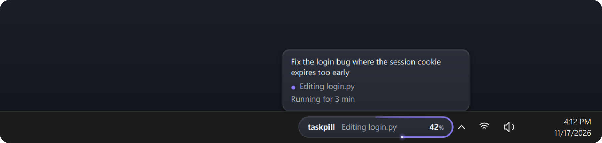
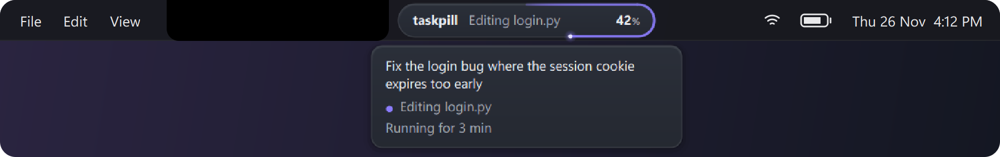
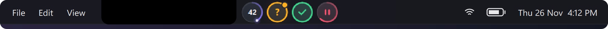
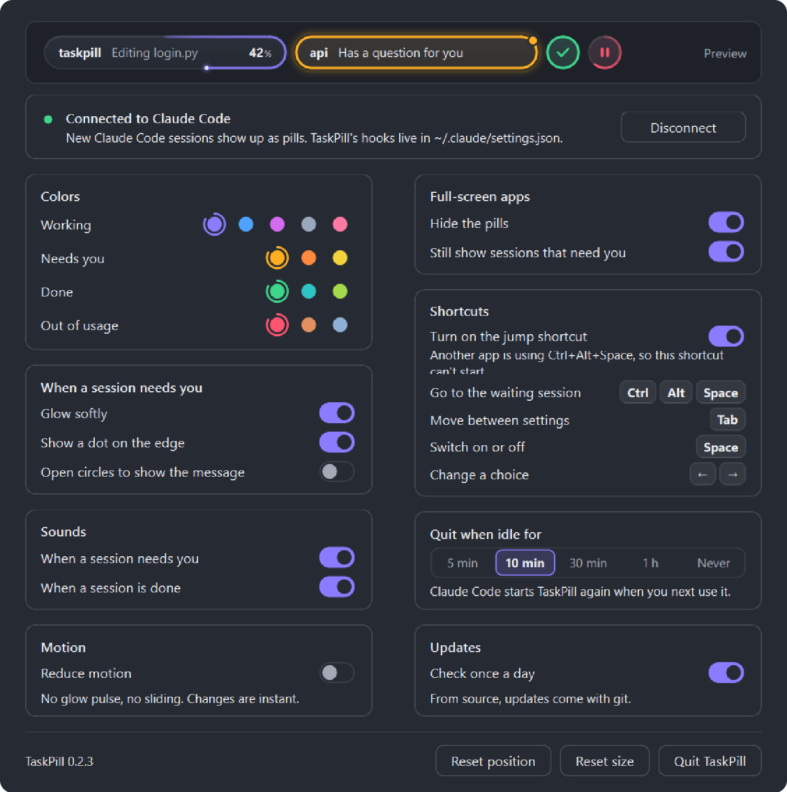

<h1 align="center">TaskPill</h1>

<b>Know what Claude Code is doing without switching windows.</b> 
A small pill on your Windows taskbar or Mac menu bar that shows each Claude Code session's progress, 
tells you the moment it needs you, and lets you know when it's done.

  <a href="../../releases/latest"><b>Download for Windows or Mac</b></a> ·
  <a href="#on-your-taskbar">What it shows</a> ·
  <a href="#on-a-mac">On a Mac</a> ·
  <a href="#privacy">Privacy</a>

**Authors:** Manasvi Mittal

You give Claude Code a task and switch to something else. Then you keep checking back. Is it still going? Is it stuck on a permission prompt? Did it finish ten minutes ago? TaskPill answers that from the corner of your eye, and gets your attention only when you're needed.

## On your taskbar

- **Working:** the outline of the pill is the progress bar. A line of light runs round the edge as the estimated % grows, next to the step Claude is on ("Editing login.py", "Running npm test").
- **Needs you:** the pill turns amber with a soft glow and a dot, and shows what Claude is asking ("Needs permission to run npm install"). A subtle chime plays.
- **Done:** the pill shrinks to a mint ✓ with a softer chime. Click it, or just switch to that window, and it goes away.
- **Out of usage:** a calm crimson pill with a pause mark when you hit a usage limit. Hover it to see Claude Code's own message, with the reset time when it gives one. It goes back to working by itself when Claude Code carries on.

## Several sessions at once

With two or more sessions, each becomes a small circle: the % while it works, **?** when it needs you, **✓** when it's done, **‖** when it's out of usage. Hover any circle for the full story.

## On a Mac

On a Mac the pill lives in the menu bar, just right of the notch (or where the notch would be on a screen without one). It's sized to fit the bar and stops before your menu-bar icons. Hover it for the same card, which opens under the bar.

A Mac starts with the compact circle, so it takes little room next to the notch. Right-click it → **Resize…** for a full pill like the one above. Everything else works as on Windows: the colors, the sounds, the jump shortcut (**Control+Option+Space**), and a click that brings the session's app forward.

## One click to the right window

Click a pill and that session's VS Code window or terminal comes to the front, even from a full-screen video or game. Over full-screen apps TaskPill stays out of the way; only a session that needs you pops up (you can turn that off too).

## Make it yours

- **A live preview** at the top of Settings shows your pills as you change them.
- **Colors** for each state: working, needs you, done and out of usage.
- **Size:** right-click → Resize… and drag. Make it wider, taller, or a single circle.
- **Sounds, glow and dot:** each can be switched off.
- **Reduce motion**, light and dark themes (it follows Windows), and full-screen behavior.

## Install (Windows 10 and 11)

1. Download **`TaskPill-Setup-<version>-Windows.exe`** from the [latest release](../../releases/latest). (Prefer no installer? Take **`TaskPill-<version>-Windows-Portable.zip`**, unzip it anywhere and run `TaskPill.exe`.)
2. Run it. It installs just for you, with no admin prompt.
   - TaskPill is free and not signed yet, so Windows may say **"Windows protected your PC"**. Click **More info → Run anyway**.
   - If **Smart App Control** is on (Windows Security → App & browser control), Windows blocks unsigned apps with no way to allow them. Signed builds are planned.
3. TaskPill asks **"Connect TaskPill to Claude Code?"** Click **Connect**. It adds a few hooks to `~/.claude/settings.json`, after making a backup.
4. Use Claude Code as usual, in VS Code or a terminal. The pill appears next to the **^** arrow on your taskbar.

You never need to start TaskPill yourself: Claude Code starts it when a session begins, and it quits after 10 quiet minutes. Open TaskPill from the Start menu any time to see Settings, even while it's already running.

**Updates:** once a day TaskPill checks for a new version. When there is one, the tray icon tells you, and one click downloads and installs it (your settings stay). You can turn this off in Settings.

**Uninstall:** Windows Settings → Apps → TaskPill → Uninstall. TaskPill's hooks are removed too (after a backup); your own hooks stay as they were.

## Install (macOS 12 or later, Apple Silicon)

1. Download **`TaskPill-<version>-Mac-AppleSilicon.dmg`** from the [latest release](../../releases/latest), open it, and drag **TaskPill** into **Applications**.
2. Open TaskPill from Applications. It's free and not notarized by Apple (that costs $99 a year), so the first time macOS says it **can't verify the developer**. Click **Done**, then go to **System Settings → Privacy & Security**, scroll down and click **Open Anyway** next to TaskPill. You only do this once.
   - Once it's running, TaskPill removes the "downloaded from the internet" mark from its own app (and nothing else), so macOS doesn't block the small helper inside it that Claude Code starts on each event.
3. TaskPill asks **"Connect TaskPill to Claude Code?"** Click **Connect**.
4. Use Claude Code as usual, in Terminal, iTerm2 or VS Code. The pill appears in the menu bar, just right of the notch (or right of the middle of the screen if there's no notch). It stays as tall as the menu bar and stops before your menu-bar icons.

What's different on a Mac:
- There's no Dock icon. TaskPill lives in the menu bar: click its ring icon for Settings, or open TaskPill from Applications again.
- The pill starts as a small circle next to the notch. Right-click it → **Resize…** for a full pill.
- Clicking a pill brings that session's app forward (Terminal, iTerm2, VS Code). If the app has several windows, macOS brings its front one; TaskPill can't pick one exact window without the Accessibility permission, which it doesn't ask for.
- The jump shortcut is **Control+Option+Space**.
- TaskPill follows **Reduce motion** and **Increase contrast** in System Settings → Accessibility → Display.
- **Updates:** TaskPill tells you when there's a new version and opens the download page; drag the new app into Applications to replace the old one (your settings stay).
- **Uninstall:** click Disconnect in Settings (removes TaskPill's hooks, after a backup), quit it, and drag TaskPill from Applications to the Bin.
- Intel Macs aren't supported yet.

## Privacy

Your sessions stay on your computer. Claude Code hands each event to TaskPill on `127.0.0.1` only, and none of it is sent anywhere. The one thing TaskPill does online is the daily update check: it asks GitHub for the latest version number, and sends nothing about you or your sessions. You can switch it off in Settings. TaskPill never sees your files' contents or Claude's replies. The hook passes along only what the pill shows: the session and its folder, your prompt, the tool being used with its file path or command (cut short), and Claude Code's error text when a turn fails.

## Status

TaskPill is new. Windows is supported; macOS support is new and still being tested.

## License

[MIT](LICENSE). Free to use, change and share. Found a security problem? See [SECURITY.md](SECURITY.md).
